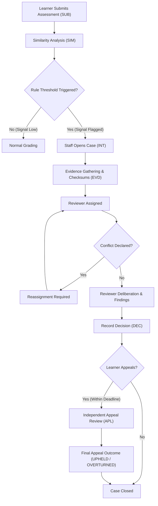

# IntegrityFlow — Academic Integrity & Fair Review Platform

> **Tagline:** *Similarity is a signal, not a verdict.*

IntegrityFlow is an end-to-end, production-style Django web application built for academic institutions and coding evaluation platforms. The system manages the entire academic integrity lifecycle—including submission intake, synthetic similarity reporting, transparent rule evaluation, evidence management, conflict-free reviewer assignments, due-process decisions, appeal workflows, and immutable audit trails.

---

## Table of Contents
1. [Core Mission & Philosophy](#1-core-mission--philosophy)
2. [Architecture & System Design](#2-architecture--system-design)
3. [User Roles & Permissions](#3-user-roles--permissions)
4. [Immutable Identifier System](#4-immutable-identifier-system)
5. [End-to-End Business Workflow](#5-end-to-end-business-workflow)
6. [Tech Stack & Dependencies](#6-tech-stack--dependencies)
7. [Repository Layout](#7-repository-layout)
8. [Installation & Local Setup](#8-installation--local-setup)
9. [Database Configuration (MySQL & SQLite fallback)](#9-database-configuration)
10. [Running the Application](#10-running-the-application)
11. [Running Automated Tests](#11-running-automated-tests)
12. [API & URL Reference](#12-api--url-reference)
13. [Security, Due Process & Auditing](#13-security-due-process--auditing)

---

## 1. Core Mission & Philosophy

In modern digital and academic assessments, automated similarity detectors produce quantitative scores, not ethical judgments. Similarity can stem from shared template code, required library imports, boilerplate syntax, or proper academic citation.

**IntegrityFlow enforces three foundational axioms:**
1. **Similarity is a Signal, Not a Verdict:** A high similarity percentage alerts staff to review context; it never automatically assigns misconduct or guilt.
2. **Transparent Due Process:** Learners have the fundamental right to view non-sensitive case summaries, understand applied criteria, review evidence provenance, and submit independent appeals.
3. **Traceability and Conflict Separation:** Every status change, assignment, decision, and appeal is logged immutably in an append-only timeline. Reviewers with declared conflicts of interest are strictly blocked from reviewing assigned cases.

---

## 2. Architecture & System Design

IntegrityFlow is designed around decoupled Django domain apps following clean architecture principles:

```
┌─────────────────────────────────────────────────────────────┐
│                       Presentation UI                       │
│    Vanilla HTML5 / CSS3 / Django Templates / Chart.js       │
└──────────────────────────────┬──────────────────────────────┘
                               │
┌──────────────────────────────▼──────────────────────────────┐
│                    Role-Based Access Control                │
│             Server-side checks via `has_role`               │
└──────────────────────────────┬──────────────────────────────┘
                               │
┌──────────────┬───────────────┴───────────────┬──────────────┐
│  Academics   │        Similarity & Rules     │    Cases     │
│  Assessments │  Synthetic Reports (SIM)      │ Case (INT)   │
│  Submissions │  IntegrityRule Engine         │ Assignments  │
│  Learners    │                               │ Decisions    │
│              │                               │ Appeals      │
└──────┬───────┴───────────────┬───────────────┴──────┬───────┘
       │                       │                      │
┌──────▼───────────────────────▼──────────────────────▼───────┐
│                    Evidence & Audit Trail                   │
│       EvidenceItem (EVD) with SHA256 checksums              │
│       CaseEvent (EVT) immutable timeline audit log          │
└──────────────────────────────┬──────────────────────────────┘
                               │
┌──────────────────────────────▼──────────────────────────────┐
│                      Database Layer                         │
│           MySQL 8.0+ (with SQLite local fallback)           │
│      Atomic select_for_update Identifier Allocation         │
└─────────────────────────────────────────────────────────────┘
```

---

## 3. User Roles & Permissions

Role-based authorization is enforced on the server, not just hidden in UI templates.

| Role | Role Key | Permissions & Capabilities |
|---|---|---|
| **Learner** | `learner` | View their own submissions and similarity alerts; view authorized case evidence; read written reviewer decisions; submit formal appeals within statutory deadlines. |
| **Instructor** | `instructor` | View cohort assessments, submissions, and similarity reports; recommend submissions for integrity review; view final case outcomes. |
| **Academic Administrator** | `admin` | Create cases from flagged submissions; manage integrity rules and threshold versions; assign and reassign reviewers; monitor deadlines and operational health. |
| **Reviewer** | `reviewer` | Examine assigned cases and evidence provenance; declare conflicts of interest; record formal findings, rationale, and procedural decisions. |
| **Support Staff** | `support` | View workflow metadata and status to assist users with process inquiries without altering academic findings. |
| **Platform Administrator** | `platform_admin` | Manage user accounts, role definitions, system settings, global audit logs, and data quality validation reports. |

---

## 4. Immutable Identifier System

To ensure cross-system traceability and audit integrity, all primary records receive human-readable, deterministic identifiers upon creation:

- **Learner Profile:** `LRN-YYYY-NNNNNN`
- **Assessment:** `ASM-YYYY-NNNNNN`
- **Submission:** `SUB-YYYY-NNNNNN`
- **Similarity Report:** `SIM-YYYY-NNNNNN`
- **Integrity Case:** `INT-YYYY-NNNNNN`
- **Evidence Item:** `EVD-YYYY-NNNNNN`
- **Reviewer Decision:** `DEC-YYYY-NNNNNN`
- **Learner Appeal:** `APL-YYYY-NNNNNN`
- **Audit Timeline Event:** `EVT-YYYY-NNNNNN`

### Concurrency-Safe Allocation
Identifiers are generated using the `IdentifierCounter` model with database-level row locking (`select_for_update()`) inside an atomic transaction. This guarantees gapless, collision-free sequencing even under high concurrent traffic.

---

## 5. End-to-End Business Workflow



1. **Submission Creation:** Learner submits work before the assessment deadline.
2. **Similarity Evaluation:** Synthetic report is generated with overall percentage, matched sources, and quotation/template indicators.
3. **Transparent Rule Matching:** Configurable integrity rules evaluate the report without deciding guilt.
4. **Case Initiation:** Academic Administrator opens a formal case (`INT-2026-XXXXXX`) referencing the triggering submission.
5. **Evidence Ingestion:** Items are attached with strict metadata: description, source reference, file upload, SHA-256 checksum, provenance, and visibility level (`public`, `restricted`, `internal`).
6. **Conflict-Free Assignment:** Qualified reviewers are assigned. If a conflict of interest is declared, decision-making is halted and reassignment is mandated.
7. **Decision Recording:** Reviewer records structured findings, applied rules, and rationale (`NO_VIOLATION`, `INCONCLUSIVE`, `POLICY_VIOLATION`, `ADDITIONAL_EVIDENCE_REQUIRED`).
8. **Appeals:** If dissatisfied, the learner submits grounds and evidence. An independent reviewer (never the original decision-maker) reviews the appeal.
9. **Audit Trail:** Every stage generates an immutable `CaseEvent` logging the timestamp, actor, event type, and JSON payload.

---

## 6. Tech Stack & Dependencies

- **Language:** Python 3.11 / 3.12 / 3.13
- **Framework:** Django 4.2+ (LTS) / Django 6.x
- **Database:** MySQL 8.0+ / MariaDB 10.5+ (SQLite built-in fallback for local zero-dependency testing)
- **Database Connectors:** `pymysql` (pure Python, cross-platform) with automatic bridge, and `mysqlclient` (C connector compatible)
- **Frontend:** HTML5, CSS3, Vanilla ES6 JavaScript, Django Template Language
- **Styling:** Custom CSS design system (`/static/style.css`)
- **Visualizations:** Chart.js

---

## 7. Repository Layout

```
IntegrityFlow/
├── academics/              # Assessments, submissions, and learner profiles
│   ├── models.py
│   ├── views.py
│   └── urls.py
├── accounts/               # Custom User model (6 roles), auth, profile views
│   ├── models.py
│   ├── views.py
│   └── urls.py
├── audit/                  # Immutable CaseEvent audit log model
│   └── models.py
├── cases/                  # Case management, reviewer assignment, decisions, appeals
│   ├── models.py
│   ├── services.py         # Transaction-safe business logic & audit dispatchers
│   ├── views.py
│   ├── urls.py
│   └── tests.py            # Automated end-to-end workflow test suite
├── evidence/               # Chain-of-custody evidence registry & checksums
│   ├── models.py
│   ├── views.py
│   └── urls.py
├── similarity/             # Synthetic similarity reports & source matching
│   ├── models.py
│   ├── views.py
│   └── urls.py
├── integrity/              # IntegrityRule models & concurrency-safe IdentifierCounter
│   └── models.py
├── data_quality/           # Data quality validation & anomaly detection suite
├── analytics/              # Aggregations, metrics, and reporting
├── static/                 # CSS stylesheets, assets, and client scripts
│   └── style.css
├── templates/              # Base HTML layout and application views
│   ├── base.html
│   └── home.html
├── config/                 # Project configuration (settings, root URLs, WSGI/ASGI)
│   ├── __init__.py         # Driver compatibility bootstrap (PyMySQL -> MySQLdb)
│   ├── settings.py         # Database configuration, apps, static/media paths
│   └── urls.py             # Route registry
├── utils.py                # Concurrency-safe identifier allocation & role verification
├── requirements.txt        # Minimal pinned dependencies
├── manage.py               # Django CLI utility
├── DEPLOYMENT.md           # Production deployment & operations runbook
├── IMPLEMENTATION_LOG.md   # Chronological development record & decisions
└── README.md               # Primary project documentation
```

---

## 8. Installation & Local Setup

### 1. Clone or Open the Workspace
```bash
cd /Users/venu/.gemini/antigravity/scratch/IntegrityFlow
```

### 2. Create and Activate a Virtual Environment
```bash
python3 -m venv venv
source venv/bin/activate
```

### 3. Install Dependencies
```bash
pip install -r requirements.txt
```
*Note: `requirements.txt` installs `pymysql` by default, ensuring immediate installation without needing native C compiler tools or `pkg-config` on macOS.*

---

## 9. Database Configuration

IntegrityFlow dynamically switches between MySQL and SQLite based on your environment.

### Option A: Local Development with SQLite (Default)
If no `DB_HOST` is specified, the application automatically uses SQLite (`db.sqlite3`). No setup needed!

### Option B: Production with MySQL
Export your MySQL credentials:
```bash
export DB_NAME="integrityflow"
export DB_USER="integrity_user"
export DB_PASSWORD="secure_password"
export DB_HOST="127.0.0.1"
export DB_PORT="3306"
```

### Apply Migrations
```bash
python3 manage.py migrate
```

### Create Administrator User
```bash
python3 manage.py createsuperuser
```

---

## 10. Running the Application

Start the Django local development server:
```bash
python3 manage.py runserver
```

Open your browser to:
- **Platform Home:** [http://127.0.0.1:8000/](http://127.0.0.1:8000/)
- **Django Admin Portal:** [http://127.0.0.1:8000/admin/](http://127.0.0.1:8000/admin/)
- **Case Management:** [http://127.0.0.1:8000/cases/](http://127.0.0.1:8000/cases/)
- **Assessments:** [http://127.0.0.1:8000/academics/assessments/](http://127.0.0.1:8000/academics/assessments/)
- **Submissions:** [http://127.0.0.1:8000/academics/submissions/](http://127.0.0.1:8000/academics/submissions/)
- **Similarity Reports:** [http://127.0.0.1:8000/similarity/](http://127.0.0.1:8000/similarity/)
- **Evidence Vault:** [http://127.0.0.1:8000/evidence/](http://127.0.0.1:8000/evidence/)

---

## 11. Running Automated Tests

Run the complete test suite:
```bash
python3 manage.py test
```

Or test specific domains:
```bash
python3 manage.py test cases
```

### Included Test Coverage
- `test_case_creation_and_audit`: Verifies case identifier formatting (`INT-YYYY-NNNNNN`), status initialization, and automated `CaseEvent` logging.
- `test_reviewer_assignment_and_conflict_prevention`: Proves that reviewers with declared conflicts are rejected at the service layer.
- `test_record_decision`: Confirms formal decision storage (`DEC-YYYY-NNNNNN`), state transition to `DECIDED`, and audit logging.
- `test_appeal_submission`: Validates learner due-process appeal filing (`APL-YYYY-NNNNNN`), state transition to `APPEAL_PENDING`, and timeline tracking.

---

## 12. API & URL Reference

| Route | View | Description |
|---|---|---|
| `/` | `home` | Landing page, platform metrics, and module links |
| `/admin/` | Django Admin | Administrative controls, user permissions, and audit inspections |
| `/accounts/` | `accounts.views.profile` | Current user profile, role display, and credentials |
| `/academics/assessments/` | `academics.views.assessment_list` | Assessment catalog and deadlines |
| `/academics/assessments/<id>/` | `academics.views.assessment_detail` | Detailed assessment instructions |
| `/academics/submissions/` | `academics.views.submission_list` | Submission dashboard (filtered by user role) |
| `/academics/submissions/create/`| `academics.views.submission_create` | Learner assessment submission portal |
| `/similarity/` | `similarity.views.similarity_list` | Similarity index and report summaries |
| `/similarity/<report_id>/` | `similarity.views.similarity_detail` | Detailed source matches and highlighted segments |
| `/cases/` | `cases.views.case_list` | Case workspace (learner/reviewer filtered) |
| `/cases/<case_id>/` | `cases.views.case_detail` | Case dossier, evidence panel, and audit history |
| `/cases/<case_id>/assign/` | `cases.views.assign_reviewer` | Reviewer assignment with conflict enforcement |
| `/cases/<case_id>/decision/` | `cases.views.record_decision` | Formal decision form and rationale entry |
| `/cases/<case_id>/appeal/` | `cases.views.submit_appeal` | Learner appeal submission portal |
| `/evidence/` | `evidence.views.evidence_list` | Chain-of-custody evidence registry |
| `/evidence/<evidence_id>/` | `evidence.views.evidence_detail` | Evidence provenance, checksum, and file access |

---

## 13. Security, Due Process & Auditing

- **Server-Side Enforcement:** Permissions are never solely client-side UI toggles. Every view checks authenticated user identity and role.
- **Data Protection & Checksums:** Evidence uploads support SHA-256 checksums to verify document authenticity and prevent silent file tampering.
- **Conflict of Interest Isolation:** Reviewers cannot review or decide cases where a conflict is declared.
- **Double-Blind Appeals:** An appeal cannot be reviewed or closed by the original decision maker.
- **Append-Only Auditing:** `CaseEvent` records cannot be updated or deleted through standard interfaces.
